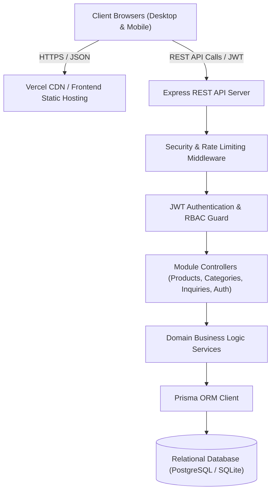

# 🏛️ AURÉLIEN Atelier System Architecture

## 1. System Overview

**AURÉLIEN** is an enterprise-grade digital flagship and boutique management platform for fine gold jewelry and bespoke high-jewelry artisans. It is architected as a decoupled client-server application adhering to Clean Architecture principles, ensuring scalability, maintainability, and high performance.



---

## 2. Layered Architecture

### A. Frontend Layer (`/frontend`)
- **Framework**: React 18+ powered by Vite for rapid HMR and optimized production bundling.
- **Design System**: Bespoke Haute Joaillerie Design Tokens implemented in Vanilla CSS (`variables.css`, `typography.css`, `animations.css`, `globals.css`).
  - Colors: Deep Obsidian (`#0b0c10`), Antique Gold (`#d4af37`), Champagne Shimmer (`#f5e6c8`), Velvet Black (`#121316`).
  - Typography: Serif display fonts (Playfair Display / Cinzel) paired with clean geometric body typography (Inter).
  - Micro-Interactions: Golden specular glows, subtle scale hover transforms, and accessible focus states.
- **State Management**:
  - React Context API for Global Session and Authentication (`AuthContext.tsx`).
  - Custom data fetching hooks (`useProducts.ts`, `useCategories.ts`) with memoization and client-side fallback to `demoProducts.ts` if offline or backend is undergoing maintenance.
- **Routing**: `react-router-dom` with declarative routes and `ProtectedRoute` guards for `/admin/*` operations.

### B. Backend API Layer (`/backend`)
- **Runtime**: Node.js v18+ with TypeScript in strict mode.
- **Framework**: Express.js configured with strict CORS, helmet-like security policies, and custom standardized response envelopes.
- **Authentication**: Stateless JSON Web Tokens (JWT) using `RS256`/`HS256` signed tokens stored in secure `Authorization: Bearer <token>` headers or HTTP-only cookies.
- **Validation**: Schema-level request validation using `zod` for type-safe payload inspection before reaching controllers.
- **Data Access**: Prisma ORM providing typed queries, schema migrations, and connection pooling.

---

## 3. Security Architecture

1. **Authentication & Authorization**:
   - Passwords hashed using `bcryptjs` with high cost salt factor (12 rounds).
   - Admin roles are enforced at the router level via `authorize(['ADMIN', 'SUPER_ADMIN'])`.
2. **Rate Limiting**:
   - Public inquiry submission endpoints are capped (e.g., 5 inquiries per 15 minutes per IP) to mitigate spam and DDoS.
3. **Data Sanitization**:
   - All string inputs are trimmed, sanitized, and type-checked to eliminate SQL injection and XSS vectors.

---

## 4. Frontend Component Hierarchy

```
MainLayout
├── SiteHeader
│   ├── Logo / Monogram
│   ├── DesktopNavigation (Collections, High Jewelry, Heritage, Contact)
│   └── MobileNavigation (Drawer, Quick Call, Inquiry CTA)
├── Page Content (e.g. HomePage, GalleryPage, AboutPage, ContactPage)
│   ├── HeroSection (Atmospheric Gold Banner & Value Proposition)
│   ├── CollectionHighlights (Bridal, Solitaires, Bangles, Necklaces)
│   ├── CraftsmanshipSection (Hallmark 916/750, Hand-Forged Accents)
│   ├── FeaturedProducts / ProductGrid
│   │   ├── ProductCard
│   │   │   ├── Image with Specular Hover
│   │   │   ├── Purity Badge (24K, 22K, 18K)
│   │   │   ├── Weight & Making Charge Details
│   │   │   └── Inquire CTA
│   └── BrandBenefits (BIS Hallmarking, Insured Delivery, Bespoke Design)
└── SiteFooter (Certificates, Boutique Addresses, Newsletter, Legal)
```

---

## 5. Reliability & Fallback Strategy

The application implements graceful degradation:
- If the backend is disconnected during local preview, the frontend seamlessly renders rich curated jewelry items from `demoProducts.ts`, notifying the user non-intrusively via UI badge.
- As soon as the backend API establishes connection, the UI switches to live database sync.
