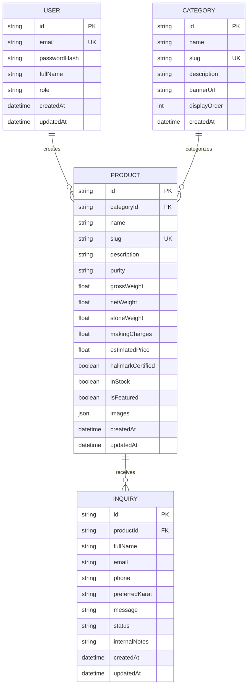

# 🗄️ Database Schema & Data Dictionary

The AURÉLIEN database uses Prisma ORM targeting relational databases (SQLite for rapid zero-dependency local development, easily swappable with PostgreSQL/MySQL for production).

## Entity Relationship Diagram (ERD)

---

## Data Dictionary

### Table: `users`
Stores administrative staff accounts and roles.
| Column | Type | Constraints | Description |
|---|---|---|---|
| `id` | String (CUID) | PRIMARY KEY | Unique user identifier |
| `email` | String | UNIQUE, NOT NULL | Account email for credentials |
| `passwordHash` | String | NOT NULL | Hashed password via bcrypt |
| `fullName` | String | NOT NULL | Display name of staff member |
| `role` | String (Enum) | DEFAULT 'ADMIN' | Role: `ADMIN`, `SUPER_ADMIN` |
| `createdAt` | DateTime | DEFAULT now() | Creation timestamp |
| `updatedAt` | DateTime | AUTO_UPDATE | Last update timestamp |

---

### Table: `categories`
Organizes jewelry into signature collections.
| Column | Type | Constraints | Description |
|---|---|---|---|
| `id` | String (CUID) | PRIMARY KEY | Category ID |
| `name` | String | NOT NULL | e.g. "Bridal Sets", "Solitaire Rings" |
| `slug` | String | UNIQUE, NOT NULL | URL-safe slug e.g. "bridal-sets" |
| `description` | Text | NULLABLE | Curatorial introduction |
| `bannerUrl` | String | NULLABLE | Visual banner image |
| `displayOrder` | Integer | DEFAULT 0 | Sorting priority in navbar |

---

### Table: `products`
The core repository of all haute joaillerie pieces.
| Column | Type | Constraints | Description |
|---|---|---|---|
| `id` | String (CUID) | PRIMARY KEY | Product ID |
| `categoryId` | String | FOREIGN KEY -> categories.id | Associated category |
| `name` | String | NOT NULL | Name of creation |
| `slug` | String | UNIQUE, NOT NULL | Unique URL slug |
| `description` | Text | NOT NULL | Detailed narrative description |
| `purity` | String | NOT NULL | Karatage purity (`24K`, `22K`, `18K`, `14K`) |
| `grossWeight` | Float | NOT NULL | Total weight in grams |
| `netWeight` | Float | NOT NULL | Pure gold weight excluding stones |
| `stoneWeight` | Float | DEFAULT 0 | Gemstones weight in carats / grams |
| `makingCharges` | Float | NOT NULL | Craftsmanship labor charges |
| `estimatedPrice`| Float | NOT NULL | Calculated showcase base price (USD/INR) |
| `hallmarkCertified` | Boolean | DEFAULT true | BIS 916 / Assay hallmark stamp |
| `inStock` | Boolean | DEFAULT true | Availability toggle |
| `isFeatured` | Boolean | DEFAULT false | Featured on flagship homepage |
| `images` | JSON / Text | NOT NULL | Array of image asset URLs |

---

### Table: `inquiries`
Client consultations, bespoke quotes, and private viewing appointments.
| Column | Type | Constraints | Description |
|---|---|---|---|
| `id` | String (CUID) | PRIMARY KEY | Inquiry ID |
| `productId` | String | FOREIGN KEY -> products.id (optional) | Item of interest |
| `fullName` | String | NOT NULL | Client name |
| `email` | String | NOT NULL | Contact email |
| `phone` | String | NOT NULL | International phone number |
| `preferredKarat` | String | NULLABLE | Karat preference |
| `message` | Text | NOT NULL | Client notes and requests |
| `status` | String | DEFAULT 'PENDING' | `PENDING`, `CONTACTED`, `SCHEDULED`, `CLOSED` |
| `internalNotes` | Text | NULLABLE | Private notes for shop manager |
| `createdAt` | DateTime | DEFAULT now() | Timestamp |
